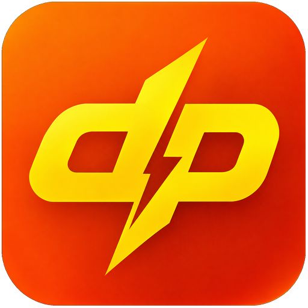
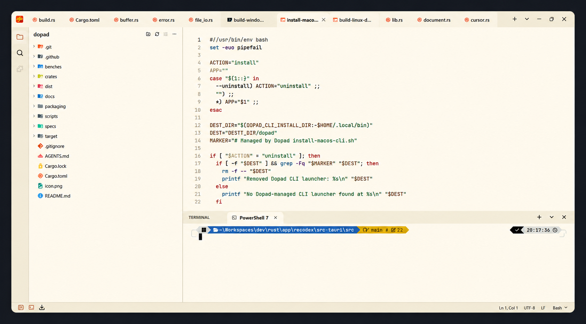

# Dopad

  
  <h2>A calm, fast editor for text and code</h2>
  
Open quickly. Keep your tools close. Stay in the flow.

  
  
  
  
  
  

   
  <a href="https://github.com/duongonix/dopad/releases/latest"><strong>Get Dopad</strong></a>
  &nbsp; · &nbsp;
  <a href="#features"><strong>Explore features</strong></a>

 

  

## A focused workspace

Dopad keeps the document in front and the rest of the workspace within easy reach. Open files in tabs, move between editing and previews in the same window, and bring search, file browsing, diagnostics, and a terminal alongside the work.

Its warm, uncluttered interface is designed to stay out of the way. Open only the panels you need, keep several documents in view, and return to editing without changing context.

## Performance without the wait

Dopad is designed around a short path from launch to editing and a responsive feel while you work.

- **Ready quickly:** the core editing workspace appears before optional language services are checked.
- **Responsive input:** file reads, preview rendering, search, and language-server work run away from the typing path.
- **Work stays bounded:** visible rows and results are rendered on demand; search results, image caches, and output logs have limits.
- **Quiet when idle:** previews, terminals, and language services are activated only when needed.
- **Useful without setup:** lightweight local completion suggestions are available even when a language server is not installed.

These are product priorities, not benchmark promises.

## Features

### Editing that stays out of your way

- Open and edit multiple files in tabs, with dirty-state indicators and drag-and-drop file opening.
- Undo, redo, cut, copy, paste, multiple cursors, and multiple selections.
- Automatic indentation, smart Home and End, duplicate line, and move lines up or down.
- Line numbers, word wrap, go to line and column, bracket matching, and automatic bracket or quote pairing.
- Preserve file encoding, byte-order marks, and line endings when saving.
- Choose installed system fonts, including Nerd Fonts, and adjust font size, weight, line height, and terminal cell width.
- Customize keyboard shortcuts and choose between Warm Paper and Tokyo Night appearances.

### Find the right text

- Search in the current file or across a chosen folder.
- Find, replace, and replace all with match-case, whole-word, regular-expression, and selection-scope options.
- See matches highlighted in the document and open search results directly at their location.
- Large result sets are bounded and displayed incrementally to keep browsing responsive.

### Helpful language features

- Syntax colors for common programming, markup, and configuration files, with automatic language detection.
- Code folding, bracket matching, comment toggling, and optional indentation guides.
- Prefix-aware completion suggestions, with local suggestions available immediately and language-server suggestions when available.
- Get contextual suggestions immediately, with optional language services adding completions and live diagnostics when available.
- Review diagnostics in Problems and inspect service messages in the shared bottom panel.

### Files, folders, and previews

- Browse folders through a lazy-loading explorer; expand only the directories you need.
- Search files and folders while respecting ignore rules and skipping binary content.
- Create, rename, delete, refresh, and reveal files from the explorer.
- Preview Markdown and SVG in the editor workspace.
- View PNG, JPEG, GIF, BMP, WebP, and ICO images with fit-to-window, zoom, pan, and file details.
- Open unsupported formats in a clear, read-only tab instead of displaying binary data as text.

### Keep your tools nearby

- Use the integrated terminal without leaving the editor.
- Switch between Terminal, Problems, and Output in one resizable bottom panel.
- Preserve terminal sessions and panel state while moving between views.
- Check for updates in the app and follow download progress.

## Open files from your terminal

The Dopad command can open a file, several files, or a folder in the desktop editor. It can also navigate to a line and column or wait for an edit to finish.

<pre><code>dopad README.md
dopad src/main.rs src/lib.rs
dopad .
dopad --goto src/main.rs:42:8
dopad --wait COMMIT_EDITMSG</code></pre>

## Downloads

The latest release includes packages for both x64 and ARM64 systems.

| Platform | Available packages |
| --- | --- |
| Windows | x64 installer and portable archive; ARM64 portable archive |
| macOS | Intel and Apple Silicon archives |
| Linux | x64 and ARM64 archives, DEB packages, and RPM packages |

<a href="https://github.com/duongonix/dopad/releases/latest"><strong>View all downloads</strong></a>

## Contributing

Contributions are welcome. Report issues, suggest improvements, or submit changes through a pull request. Accepted contributions are distributed under the Dopad Community License, and contributors retain copyright to their work.

You may inspect, modify, build, and share Dopad forks for noncommercial purposes. Commercial use or distribution of a forked or modified build requires separate written permission. The official, unmodified Dopad releases may be used as allowed by the license.

## License

Dopad uses the **Dopad Community License (Non-Commercial Forks) 1.0** in [LICENSE](LICENSE). It is source-available and intentionally restricts commercial fork builds. It is not an OSI-approved open-source license: the Open Source Definition does not permit restrictions on business use or other fields of endeavor ([details](https://opensource.org/osd)).

Third-party materials with their own license or notice remain under those terms.
